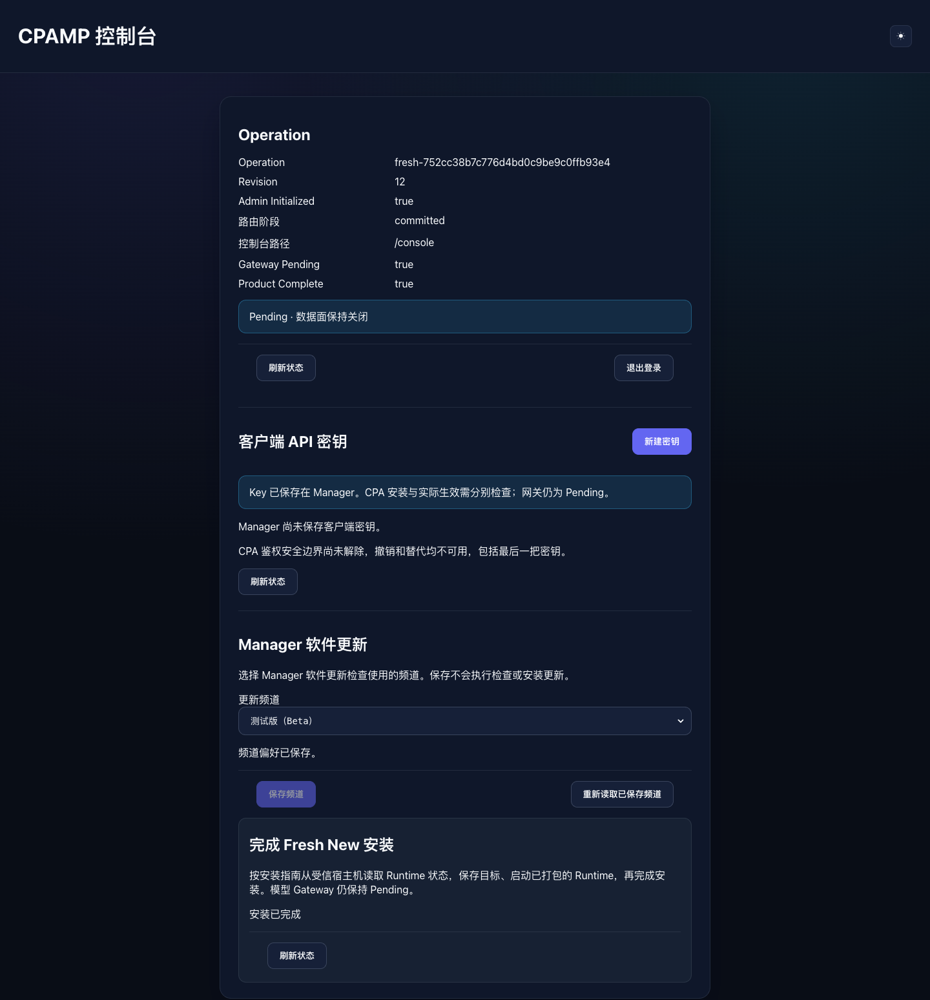
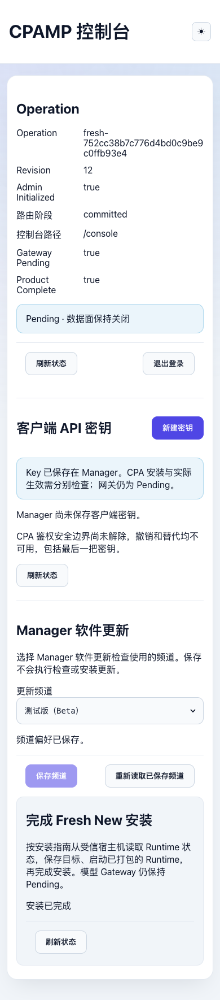

# Fresh New installation acceptance — 2026-10-20

Outcome: **PASS for the bounded private Linux/amd64 Fresh New journey**.
The browser completed installation, logged into Console and recovered the same
installation after Manager, Runtime and Ingress restarted. Model Gateway remains
Pending. This is a Draft review candidate, not a Beta/Release or public Gateway
qualification. Independent acceptance of the latest PR HEAD remains required.

## Reproduce and identify the source

Follow [the operator guide](fresh-new-installation.md), or run
`bin/ci/fresh-new-installation.mjs` with task-built normal Runtime/Manager/Ingress
images and a new output directory. The checked-in
[machine report](evidence/fresh-new-installation/report.json) records exact local
image IDs, source-file SHA256 values, the pre-commit baseline and the observed
wire generations. The report's source hashes were compared to the final task
source before committing; all matched.

- Product baseline: `v2@5ae3ea874fe241cda093402ca7aefa99ca516b8a`, fetched and
  verified against live remote `v2`; no silent local-base substitution.
- Images were built from the task working tree before the commit. Manager's
  `SourceCommit` build argument is explicitly the baseline with a
  `-fresh-worktree` suffix, **not** a claim that the baseline contains this UI.
  Use the source hashes and image IDs to identify the tested bytes; the exact
  resulting Git HEAD is recorded in the Draft PR.
- Docker Desktop daemon: real `linux/amd64`; Chrome controlled by Playwright on
  macOS accessed the real published Ingress port. No mocked application server.
- Default official CPA **8.0.13** executable:
  `sha256:b682e9e42586263f476888361514f68f89ff4ebf89a5dadba394b850b797ce41`.
  The packaged and running executable hashes matched; Runtime reached `ready`.
  The CPA config remained byte-identical to the normal v8 bootstrap seed.
- Random task Compose project, fresh named volumes, fixed random loopback port,
  ordinary separate container namespaces. No S1/S2 Provider seed, client-key
  installation, namespace joining, shared Docker state or public port opening.

## Actual validation

| Layer | Result | Observed evidence |
| --- | --- | --- |
| Web TypeScript | PASS | `npm run type-check` |
| Web Lint | PASS | `npm run lint`; zero errors, four pre-existing Accounts warnings |
| Web full unit suite | PASS | `npm --workspace apps/web run test -- src --maxWorkers=4`: 251 files, **4083 tests** |
| Final Full Web regression | PASS | `npm --workspace apps/web run test -- src/fullweb`: 12 files, **225 tests** |
| Web build | PASS | `npm run build`; Full Web and Panel, loading graph and single-file Panel checks |
| Manager/Bootstrap focused Go | PASS | `fresh`, `freshrouting`, `bootstrapdiscovery`, `freshbootstrap`, `http/fullweb`, `freshstore`, `security`, `processlock`, `legacypreflight`, `cmd/cpa-manager-plus`, and `freshstrategy` |
| Manager affected race tests | PASS | `go test -race` on `fresh`, `freshrouting`, `freshstore`, `freshbootstrap`, `freshstrategy` |
| Linux/amd64 image builds | PASS | Normal Runtime target, Ingress, Manager including packaged Full Web embed smoke |
| Real Docker installation | PASS | Full machine report; actual CPA ready, all required persistent installation fields and setting survived restart |
| Interactive browser | PASS | Real claim/generation/commit/routing/login/Runtime/complete/settings/relogin operations; no uncaught page errors |
| UI layout | PASS | zh-CN desktop dark at 1440px and mobile light at 390px; no horizontal overflow, rendered screenshots inspected |
| Fixture cleanup | PASS | Only the randomly named task Compose project and helper volumes removed |

The focused Go command was executed from `apps/manager-server`:

```sh
go test ./internal/service/fresh ./internal/service/freshrouting \
  ./internal/service/bootstrapdiscovery ./internal/http/controller/freshbootstrap \
  ./internal/http/fullweb ./internal/repository/freshstore ./internal/security \
  ./internal/processlock ./internal/service/legacypreflight ./cmd/cpa-manager-plus
go test ./internal/service/freshstrategy
go test -race ./internal/service/fresh ./internal/service/freshrouting \
  ./internal/repository/freshstore ./internal/http/controller/freshbootstrap \
  ./internal/service/freshstrategy
```

## Real failure and recovery cases

- First boot did not create a database/data key before Host `initialize`.
- Expired claim was rejected by the real service, using an explicitly injected
  expiry timestamp in a stopped, disposable fixture; wrong installation identity
  did not consume the valid claim; consumed claim was rejected in a second tab.
- Missing/weak Admin Key was blocked in the UI; missing/wrong Console credentials
  did not authenticate. Admin generation and initialization used the real server.
- The real admin commit completed, then browser delivery and the first state
  read were deliberately aborted. Key editing/submission locked. Manual state
  refresh recovered initialization with **one** admin commit request.
- First activation received a controlled 503. The original persisted target
  stayed locked. A subsequent real activation completed with its reply aborted;
  the exact public identity leaf recovered the committed Console link.
- Large uint64 Runtime generations were identical on the Host observation,
  stage request and Start request. Start completed but its browser reply was
  aborted; the existing checkpoint read recovered it without another Start.
- Installation completion and update-channel preference were actually written.
  Browser reload after restarting all three components required Admin relogin
  and recovered the same operation, routing, completion, setting and `data.key`.
- Supervisor restart created a new generation and left CPA offline. Replaying
  the old installation target returned exactly
  `409 managed_target_identity_mismatch`, without mutation/rebinding. A separately
  authorized Host lifecycle Start read the current generation and restored
  `ready`; installation provenance remained unchanged.
- Completed installation rejected another Host `initialize`. Every settings
  value, including admin verifier and Fresh authority, stayed identical, as did
  identity/key files. The existing SQLite open/migration path can change pager
  bookkeeping, so this assertion compares logical values rather than requiring
  an owned database's physical file hash to stay unchanged.
- Existing empty database, unknown schema, legacy-shaped `settings.setup` and
  malformed admission-marker fixtures all rejected Fresh admission; original
  source bytes, ownership and modes remained unchanged.
- No/wrong Client Key on models/chat/responses/messages/v1beta stayed HTTP 503
  Gateway Pending, including after restarts/Host recovery. An ordinary network
  peer could not reach CPA port 8317. No browser storage or secret service logs.

## Three self-review passes and fixes

1. **User operation and recovery:** connected the existing Console to staged
   New Managed/Start/completion; removed blind admin retry guidance; kept
   unknown writes locked and read durable state. The full real browser run
   confirmed each positive operation and recovery step.
2. **Identity, data, concurrency and restart:** real Docker exposed uint64
   generation precision loss that small synthetic fixtures missed. Added narrow
   lossless handling of Runtime fence fields, not another protocol. Retained
   the original admin candidate/commit ID and Runtime target after an attempted
   write, including a pending state read, to avoid racing a still-finishing
   original request. Rejected malformed or regressing authoritative state;
   verified one in-flight Start, target mismatch STOP and affected race tests.
3. **Scope, compatibility and complexity:** no Manager Key/Admission, Ingress,
   private Provider seed, S2-B proof, DB/schema, Docker or default-version policy
   edits. No second wizard, Bootstrap service, operation ledger, settings platform
   or new dependency. Existing APIs own every durable transition. The original
   dirty source checkout and sibling worktrees remain untouched. Full Web loading
   boundaries and the single-file Panel build passed.

Verification-harness fixes retained the real routing contract rather than
changing product code: Console navigation probes require `Accept: text/html`;
host ports must stay fixed across restart; process hashes are read as CPA's
existing UID; readiness is polled after a successful spawn without repeating
Start; stopped/no-WAL read-only SQLite evidence uses an immutable read.

No further confirmed issue remains in the tested slice after these passes.

## Limits and remaining acceptance

- **NOT RUN:** natural ten-minute wall-clock claim expiry; positive manual-key
  browser variant (generated-key path was run); other browser engines, en/zh-TW/ru
  live layouts; full Manager repository suite/vet beyond the focused runs above.
- **NOT RUN / outside this task:** other four Fresh/Upgrade paths, real Provider
  requests, public Gateway, arm64/native host support, abrupt power loss,
  production backup/restore or rollback, Beta/Release qualification.
- Supervisor container restart still requires an explicit Host lifecycle Start;
  no automatic generation rebind or new restart policy is introduced.
- Remote CI and independent acceptance must be checked on the latest Draft HEAD.
  Local results do not claim those remote checks or authorize merging.

## Screenshots





## Candidate refresh — 2026-10-27

The embedded candidate lane re-ran this journey on three locally built
`linux/amd64` candidate images from `v2@49579583` plus the tooling commits on
`build/v2-candidate-smoke-refresh` (tested HEAD
`4eee135cb23579f15a22b8d9ab15e1e2f4ccdaa9`). Build, structural verification,
`docker load` identity check and the disposable smoke all passed on exactly those
images; see
[candidate-smoke-20261027.md](evidence/fresh-new-installation/candidate-smoke-20261027.md)
for digests, per-check results and re-run commands. That record is local-only
evidence, not a Beta/Release qualification.

Differences from the 2026-10-20 record:

- The Fresh setup now finishes in the Bootstrap wizard before Console login, so
  the automated journey drives that wizard instead of the retired claim page and
  Console-side installation wizard.
- `/health` is asserted `503` before Host initialize and `200` with the Manager
  service identity after the Fresh store takeover.
- A CPA data-layer step (one management read through the `cpamp/` bridge, one
  Client Key creation plus initial install, one real model request) is present
  and currently reported `DEFAULT AUTHORITY MISSING`: the default installation
  carries no CPA management authority until lane P lands, so those rows are a
  labelled gap rather than a pass or a tool failure.
- The managed retry configuration layout check is `NOT RUN` while the gateway
  allowlist exposes no retry field.
